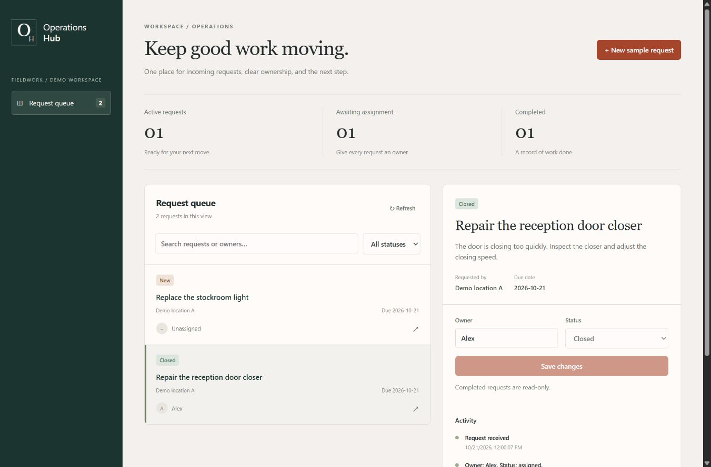

# Operations Hub

An original portfolio prototype for a fictional maintenance business: deliver a service request through an authenticated webhook, save it once, assign an owner, and track the work to closure.

Built with TypeScript, React, Node.js, and SQLite. No employer code, internal materials, client data, or third-party platform integration is included. This is a self-initiated demonstration; no customer outcomes or time savings are claimed.



[Mobile layout](docs/images/mobile.png) · [Failure and retry state](docs/images/failure.png) · [Verification record](docs/VERIFICATION.md)

## Run locally

Verified on Windows with Node.js 22.14.0 and npm 10.9.2. This version uses Node's built-in SQLite API, which emits an experimental-feature warning on the verified runtime.

```sh
npm ci --ignore-scripts
npm test
npm run build
npm start
```

Open **http://localhost:5100/**. The server binds to 127.0.0.1. The interface is a local operator workspace, not a publicly hosted application.

## Try the workflow

1. Choose **New sample request**. Submit the fictional maintenance details.
2. A server-side adapter delivers the event over HTTP to the authenticated webhook. Its credential never goes to the browser.
3. Choose **Resend last delivery**. The same saved request returns; no second request or activity entry is created.
4. Set an owner and move the request to **Assigned**, then **In progress**, then **Closed**. Closed requests are read-only.
5. Refresh or restart the application: saved requests and activity remain in the SQLite file.

The sample form is a demonstration sender, not an integration with a commercial form provider. It is intentionally limited to the local workspace. Use fictional information only.

## Configuration

| Variable            | Default                            | Purpose                                                   |
| ------------------- | ---------------------------------- | --------------------------------------------------------- |
| PORT                | 5100                               | Local listening port                                      |
| HUB_DATABASE        | data/operations.db                 | SQLite database path                                      |
| HUB_INTEGRATION_KEY | Random, generated in server memory | Shared secret for webhook callers; at least 24 characters |

The built-in sample sender uses the server's integration key automatically. To test with an independent sender, set HUB_INTEGRATION_KEY before starting the server and send it in the X-Integration-Key header. Do not put a real key in source control or browser code. An automatically generated key changes on restart; existing saved records remain.

## Webhook contract

`POST /webhooks/requests` requires `Content-Type: application/json` and `X-Integration-Key`.

```json
{
  "eventId": "sample-event-001",
  "request": {
    "title": "Repair the reception door closer",
    "description": "Inspect the closer and adjust its closing speed.",
    "requester": "Fictional location A",
    "priority": "normal",
    "dueDate": "2026-11-01"
  }
}
```

Event IDs are unique across the single demonstration integration. Priority is normal or urgent. Dates must be valid YYYY-MM-DD calendar dates. Unknown fields and oversized values are rejected. Request data is normalized by trimming its text fields before its fingerprint is calculated.

| Response          | Meaning                                                      |
| ----------------- | ------------------------------------------------------------ |
| 201               | New request saved, duplicate=false                           |
| 200               | Matching repeat delivery, duplicate=true; no new activity    |
| 400 / 415 / 422   | Malformed JSON, wrong content type, or invalid fields        |
| 401               | Missing or incorrect integration key                         |
| 409               | Existing event ID with different normalized request contents |
| 503 + Retry-After | Save unavailable; retry the same event ID and contents       |

Responses include a correlationId and the X-Correlation-ID header. Requests retain their original intake reference. Diagnostic logs contain method, HTTP status, and reference only; they omit payloads and credentials. The integration sender retries manually; there is no unattended retry scheduler or dead-letter queue.

## Operator API

- GET /api/requests: list saved requests.
- GET /api/requests/:id: request details and ordered activity.
- PATCH /api/requests/:id: complete owner, status, and current version fields.
- POST /api/sample-requests: local demonstration form adapter.

The workflow is new → assigned → in_progress → closed. Assignment requires an owner. An optimistic version check prevents one operator update from silently overwriting another. A no-op save does not add activity. Search and filtering run in the browser; this first version loads the queue in one response.

## Architecture and decisions

```text
React sample form → local server-side adapter → authenticated HTTP webhook
                                               ↓
                                 validate → transaction → SQLite
                                               ↓
                                  operator queue + activity history
```

SQLite enforces a unique event ID. A BEGIN IMMEDIATE transaction checks the prior fingerprint and commits the request and its first activity entry together. If either insert fails, neither is kept. Separate database connections therefore cannot each accept the same event. WAL mode and a bounded busy timeout support these small concurrent writes.

The frontend is a lightweight React application bundled with esbuild. The Node HTTP server serves its assets and API on one origin. A small dependency surface keeps the core workflow inspectable. The database and any runtime configuration are ignored by Git.

## Verification

Run npm test for HTTP integration and database tests. They cover:

- Matching sequential and simultaneous deliveries, plus writes from independent SQLite connections.
- Conflicting payloads, invalid input, missing credentials, malformed JSON, and unsupported content types.
- Persistence after closing and reopening the database.
- Temporary failure and retry using the same event ID.
- Atomic rollback when the activity insert fails.
- Owner requirements, workflow transitions, optimistic concurrency, and closed-record protection.
- The server-side sample adapter, correlation references, and logs without payloads or keys.
- Host and browser-origin checks for the local-only prototype.

Browser verification and screenshots are recorded separately in the project handoff. Automated tests do not claim independent accessibility certification or production readiness.

## Scope and limitations

- Local-only operator access; no user sign-in, role management, or multi-tenant isolation. Do not expose this operator API publicly.
- SQLite is persistent on the local filesystem. Deploying on ephemeral serverless storage would lose that guarantee. Public hosting needs a deliberate persistent-storage and access-control design.
- Manual retries, one integration namespace, no email delivery, payments, AI triage, or real external-provider connection.
- Activity history is operational application history, not a tamper-proof audit ledger.
- No backup/restore service, pagination, production load testing, or scheduled processing.
- A future public demo should use isolated browser-local edits or protected operator access, as described in the portfolio brief. This prototype is not that public sandbox.

## Contributions

Original project implementation includes the intake contract, backend, SQLite data model, deduplication and update behavior, React interface, tests, and documentation. Developed with AI assistance; the repository records the implementation and its validation rather than attributing unverified commercial experience.
